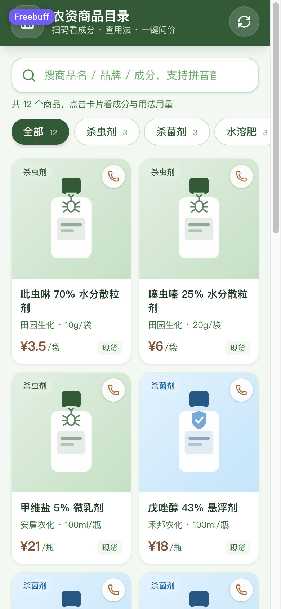
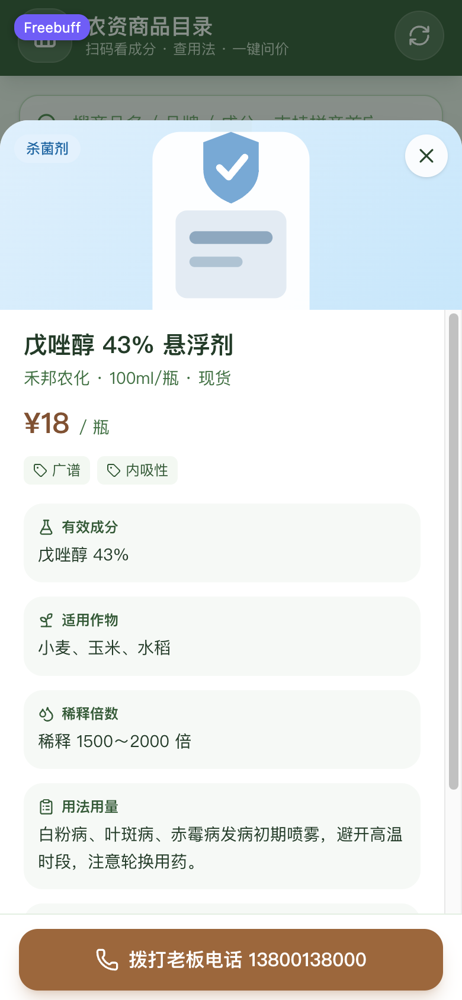
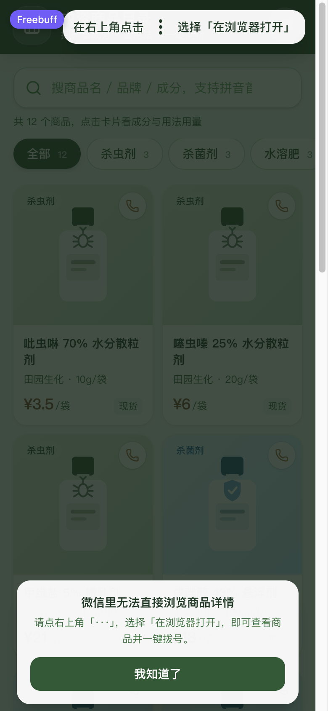
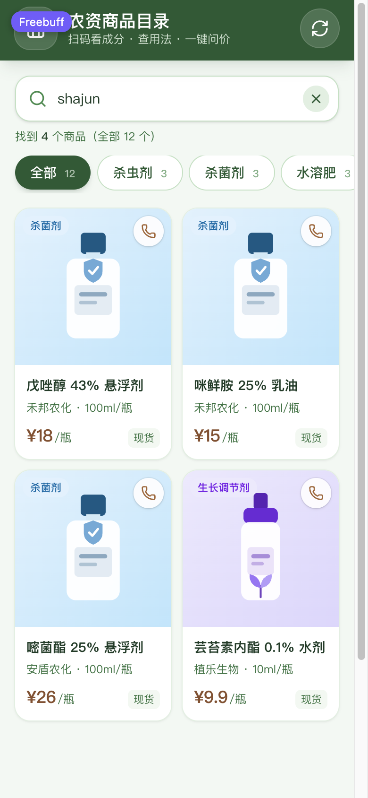
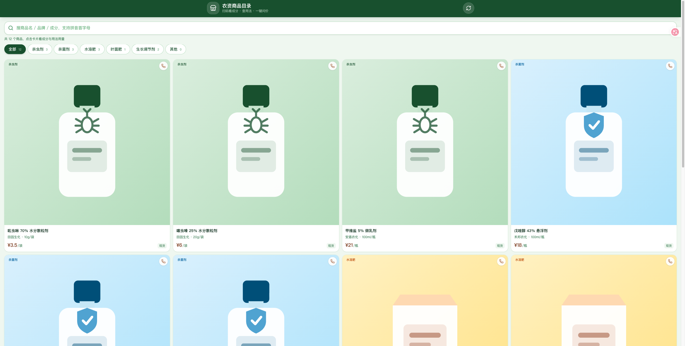

# 农资商品目录 · 静态 H5 + Android WebView 壳

面向农资商户的「扫码即用」商品目录：农户扫二维码就能查成分、看适用作物、查稀释倍数与用法用量，并**一键拨打老板电话**。

- **零服务器成本**：前端是纯静态站点，`npm run build` 出来的 `web/dist` 可以直接丢到 Cloudflare Pages / GitHub Pages / 任何静态托管。
- **一仓库两产物**：`web/` 是 H5，`android/` 是套壳 App，GitHub Actions 云端自动编译 APK。
- **数据可换**：默认读 `web/public/products.json`，也支持从飞书多维表格（Bitable）只读拉取，拉不到时自动降级到内置示例数据。

> 想换个行业再搭一套、或者想知道飞书 / Cloudflare / GitHub 上每一步手动怎么点，看
> **[docs/PLAYBOOK.md](docs/PLAYBOOK.md)**（实施时间线、改造清单、手动配置步骤、排错对照表）。

---

## 界面预览

| 商品网格 | 详情抽屉 | 微信引导 |
| --- | --- | --- |
|  |  |  |



线上实景（<https://nongzi.pages.dev>）：



---

## 目录结构

```text
.
├── web/                        # 前端工程（Vite + Vue 3 + Tailwind CSS）
│   ├── public/                 # 静态资源：products.json、config.js、og-cover.jpg、app-release.apk
│   ├── functions/              # Cloudflare Pages Functions（同源后端）
│   │   ├── _lib/               # 公共层：飞书访问、字段白名单、分享卡片 meta
│   │   ├── api/[[path]].js     # /api/products、/api/media
│   │   ├── p/[id].js           # 商品分享页 /p/<record_id>（注入 og 卡片）
│   │   ├── sitemap.xml.js      # 动态站点地图
│   │   └── robots.txt.js       # 动态 robots（带 sitemap 地址）
│   ├── src/
│   │   ├── components/         # 网格 / 详情抽屉 / 图片轮播 / 搜索 / 分类 / 微信引导 / Toast
│   │   ├── composables/        # useCatalog（数据+筛选）、useAdmin、useWechat、useToast
│   │   ├── data/               # 分类字典、示例数据
│   │   ├── services/           # 数据源：products.json / 飞书 Bitable / Mock
│   │   └── utils/              # 拼音模糊搜索、拨号、分类配色
│   └── vite.config.js
├── scripts/health-check.py     # 每日体检 + 商品快照（CI 与本地通用）
├── backups/                    # 每天一份商品快照，保留 30 天
├── android/                    # 极简 Android 壳（Gradle + Java WebView）
│   ├── app/src/main/AndroidManifest.xml
│   ├── app/src/main/java/com/nongzi/app/MainActivity.java
│   └── build.gradle
└── .github/workflows/
    ├── build-apk.yml           # 云端编译 APK + 打包 H5 产物
    ├── health.yml              # 每天体检 + 备份表格快照
    └── deploy-pages.yml        # 可选：一键发布到 GitHub Pages
```

---

## 一、本地跑起来

```bash
cd web
npm install
npm run dev        # http://127.0.0.1:5173
```

生产构建与预览：

```bash
cd web
npm run build      # 产物在 web/dist
npm run preview    # 本地预览构建结果
```

搜索逻辑有独立校验脚本：

```bash
cd web
npm run test:search
```

## 二、数据怎么接

### 方式 A：本地 `products.json`（默认）

编辑 `web/public/products.json`，字段如下：

```json
[
  {
    "id": "p-001",
    "name": "吡虫啉 70% 水分散粒剂",
    "brand": "田园生化",
    "category": "杀虫剂",
    "spec": "10g/袋",
    "price": 3.5,
    "unit": "袋",
    "images": [],
    "ingredients": "吡虫啉 70%",
    "crops": ["水稻", "棉花", "蔬菜"],
    "dilution": "稀释 3000～5000 倍",
    "usage": "蚜虫、飞虱发生初期兑水均匀喷雾，每 7～10 天一次。",
    "precautions": "不可与强碱性农药混用，桑蚕期禁用。",
    "tags": ["内吸性", "低毒"],
    "stock": "现货",
    "phone": "13800138000"
  }
]
```

`category` 支持归一化：`杀虫/杀虫类/除虫 → 杀虫剂`，`杀菌/杀菌类/霜霉 → 杀菌剂`，`水溶肥料 → 水溶肥` 等。

### 方式 B：飞书多维表格（Bitable）—— 当前线上在用

**改表格 = 改线上商品，刷新即生效，不用重新部署。** 数据链路：

```
飞书多维表格 ─┬─► /api/products  商品字段（Pages Function，web/functions/api/\[\[path\]\].js）
              └─► /api/media     图片附件（同源代理 + 边缘长期缓存）
                        │
                        └─► H5 / Android 壳
```

为什么要有这一层：飞书开放平台不放行跨域（浏览器直连会被 OPTIONS 预检挡掉），而且 `app_secret`
绝不能进前端产物。Function 用服务端凭证换 `tenant_access_token`、按 `page_size=500` 翻页拉全表，
把 `{ items, updatedAt }` 原样交给页面，前端再按同义词表把列名映射成商品字段。

**1. 飞书侧**（一次性）：

- 建一个**企业自建应用** → 拿 `App ID` / `App Secret`；
- 开通权限：`bitable:app:readonly`（读表）、`base:table:read`、`base:record:read`，
  **`drive:drive:readonly`（下载「图片」列的附件）**，
  如需从代码/脚本改数据再加 `base:field:create`、`base:record:create`、`base:record:update`，
  要脚本上传图片再加 `drive:drive`；
- 在「版本管理与发布」里创建版本并发布，**权限只有发布后才生效**；
- 把这个应用**加为多维表格的协作者**（表格右上角「...」→ 添加文档协作者），否则接口返回 `1254302`。

> **当前这张表是怎么来的**：`农资商品目录` 是用应用身份（`POST /bitable/v1/apps`）建的，
> 所以**文档所有者是应用机器人，不是你**。第一版没配分享，用个人账号点开会被要求
> 「向农资商品目录申请权限」，而所有者是个机器人，没人能点批准，永远卡住——这不是 bug，
> 是建表方式造成的。已改成「组织内拿到链接即可编辑」：
>
> ```bash
> PATCH /open-apis/drive/v1/permissions/{app_token}/public?type=bitable
> {"link_share_entity":"tenant_editable","external_access":false}
> ```
>
> 改完同组织账号点链接就能直接改，不用再申请。
>
> **想把表真正拿到自己名下**（例：换成商户自己的空间、或以后移交给供应商）：
> 在飞书里对这张表「创建副本」→ 把 Cloudflare 的 `FEISHU_APP_TOKEN` / `FEISHU_TABLE_ID`
> 换成副本链接里那两段并重新部署 → 再把应用加为副本的文档协作者（不加会报 `1254302`）。

**2. Cloudflare Pages 侧**：项目 `nongzi` → 设置 → **变量和密钥**，添加（建议选「加密」）：

| 变量名 | 说明 |
| --- | --- |
| `FEISHU_APP_ID` | 自建应用 App ID |
| `FEISHU_APP_SECRET` | 自建应用 App Secret（加密） |
| `FEISHU_APP_TOKEN` | 多维表格链接里 `/base/` 后面那段 |
| `FEISHU_TABLE_ID` | 链接 `?table=tbl...` 那段 |
| `FEISHU_DOMAIN` | 可选，Lark 国际版填 `https://open.larksuite.com` |
| `FEISHU_CACHE_TTL` | 可选，记录缓存秒数，默认 `30` |
| `FEISHU_REV` | 可选，附件下载的 `extra.bitablePerm.rev`，一般留空（按 `0`） |
| `FEISHU_HIDDEN_FIELDS` | 可选，逗号分隔的「不对外」列名。**填了就完全按你列的来**，内置黑名单（成本/进价/利润/备注…）不再生效 |

改完变量要重新部署一次才生效（推一次 commit 即可）。

**3. 前端侧**：`web/public/config.js` 里 `bitable.enabled = true`、`bitable.proxy = true` 即可，
不需要在浏览器里填任何凭证。表头按 `商品名称 / 品牌 / 分类 / 规格 / 价格 / 图片 / 成分 / 适用作物 /
稀释倍数 / 用法用量 / 注意事项 / 联系电话` 等同义名自动匹配，`杀虫类 → 杀虫剂` 这类写法也会归一化。

**行为细节**：

- 表格内容默认缓存 30 秒（同一个 Function 实例内），刷新页面最多滞后半分钟；
- 想立刻看到改动，点页面上的「重新加载商品」，它会带 `?fresh=1` 跳过缓存；
- 接口挂掉/没配变量时会自动降级到 `products.json`，页面顶部会给出提示，不会白屏；
- GitHub Pages 备用站没有 Functions，`/api/products` 会落到 `index.html`，前端识别到不是 JSON 后
  同样降级到 `products.json`。

> 想改数据：直接把链接发到飞书 App / 网页版，在表格里改单元格、加行删行都行。不要动表头文字
> 和列名，否则得同步改 `web/src/services/productSource.js` 里的同义词表。

**商品图片**：表格里的「图片」列是**附件**类型，点单元格把照片拖进去即可，**一个格子可以放多张**，
顺序就是轮播顺序（建议：药瓶/包装 → 标签细节 → 实际使用效果 → 案例）。
卡片显示第一张，右下角标图集张数；详情页是可左右滑的轮播（圆点 + 页码 + 缩略图条），
点一下进大图，支持左右切换和 Esc 关闭。
另外建「效果图」「案例图」「实拍图」之类的列也会自动并入同一个图集（「图片」列排最前）。
飞书返回的附件地址需要 `Authorization` 头，浏览器 `` 发不出去，所以页面用的是
`/api/media?file=<file_token>`：由 Function 带凭证去飞书取图、直接回图片字节，并做
`immutable` 长缓存（换一张图就是新的 `file_token`，所以能安全永久缓存）。
只有表格里真实存在的 `file_token` 会被放行，无法拿它当任意文件下载器。
卡片用 `loading="lazy"`，滑到才请求。**建议先把照片压到 500KB 以内再上传**（手机流量友好）。

### 内部列不会外发（字段白名单）

表格里加「进货价 / 成本 / 毛利 / 备注 / 供应商」这类列，顾客**看不到**：`/api/products` 在服务端就把这些列丢掉了（默认按关键词匹配，见 `web/functions/_lib/feishu.js`）。
需要的列名不在默认黑名单里，用 `FEISHU_HIDDEN_FIELDS` 精确指定，例：`FEISHU_HIDDEN_FIELDS=底价,供货商,到期日`。
注意：**一旦设置这个变量，默认黑名单就不再生效**，成本类列记得自己加进去。

### 分享卡片与搜索收录

每个商品有自己的地址：`https://站点/p/<record_id>`。打开详情时地址栏会自动变成它，抽屉右上角 ↗ 按钮一键复制。

- 发到微信群/朋友圈，卡片会显示**商品名 + 实物图 + 品牌规格**，而不是一行网址；
- 商品页由 `web/functions/p/[id].js` 在服务端注入 `og:` 标签和 `Product` 结构化数据（JSON-LD），搜索引擎不跑 JS 也读得到；
- `/sitemap.xml` 实时列出全部商品页，`/robots.txt` 指向它，所以表格加商品后不用重新部署就能被收录；
- 默认分享封面是 `web/public/og-cover.jpg`（1200×630），想换就替换这张图；站点名称在 `web/functions/_lib/meta.js` 的 `SHOP_NAME`。

### 每天自动体检 + 备份

`.github/workflows/health.yml` 每天北京时间 09:15 跑一次 `scripts/health-check.py`：

1. `/api/products` 有没有货、每条记录有没有 `record_id`；
2. 表格里第一张图能不能通过 `/api/media` 真取到字节（不是 401/404 的错误页）；
3. `robots.txt` / `sitemap.xml` 是否正常；
4. 通过后把整表存成 `backups/YYYY-MM-DD.json`，只留最近 30 天。

任何一步失败 → Actions 变红 → GitHub 发邮件，这就是零成本的监控。想本地手动跑：

```bash
python3 scripts/health-check.py https://nongzi.pages.dev
```

### 管理入口默认隐藏

这个 H5 是供应商给农资店老板看的，顾客不需要（也不应该）看到数据源设置，所以入口默认不显示。
供应商自己需要排查时，两种方式打开：

- 地址后面加 `?manage=1`（或 `?admin=1`）；
- 3 秒内连点页面标题 5 下。

打开后顶部右上角和页脚会出现数据源按钮，可以临时切到「本地 products.json」排查问题；
弹窗底部有「退出管理模式」，关掉后按钮就重新隐藏（状态存在 localStorage）。

## 三、H5 里的一键拨号

- H5 侧点击「联系老板」→ `tel:` 链接（微信内置浏览器里会自动复制号码并提示用系统拨号盘）。
- Android 壳里 `WebViewClient.shouldOverrideUrlLoading` 拦截 `tel:`，用 `Intent.ACTION_DIAL` 调起系统拨号盘（用户确认后才真正拨出，不需要 `CALL_PHONE` 权限）。

## 四、Android 壳

```bash
cd android
./gradlew assembleRelease     # 产物：android/app/build/outputs/apk/release/app-release.apk
```

- 需要 **JDK 17**（`java -version` 应输出 17.x）。CI 里已经用 `actions/setup-java` 配好了。
- 国内网络拉依赖慢或握手失败时，开阿里云镜像：

```bash
./gradlew assembleRelease -PuseCnMirror=true
```

- 加载的线上地址默认是 `https://nongzi.pages.dev`，三种覆盖方式：
  1. `./gradlew assembleRelease -PwebUrl=https://你的域名`
  2. 环境变量 `WEB_URL=https://你的域名`
  3. 直接改 `android/app/build.gradle` 里的默认值
- 硬件返回键优先回退网页历史，栈空时才退出应用。
- 已开启 `INTERNET` 权限、`usesCleartextTraffic` 与 `networkSecurityConfig`，http 站点也能正常打开。
- 正式签名：复制 `android/keystore.properties.example` 为 `android/keystore.properties` 并填好密钥库信息；没有配置时 CI 退回 debug 签名，照样能装。

## 五、上线三步

> 本仓库已经上线，以下就是实际配置：
>
> | 项目 | 地址 |
> | --- | --- |
> | GitHub 仓库 | <https://github.com/liuxqchn/nongzi> |
> | H5 线上站点（主） | <https://nongzi.pages.dev> （Cloudflare Pages） |
> | H5 备用站点 | <https://liuxqchn.github.io/nongzi/> （GitHub Pages，`deploy-pages.yml` 自动发布） |
> | APK 下载 | <https://nongzi.pages.dev/app-release.apk> |
> | 仓库变量 `WEB_URL` | `https://nongzi.pages.dev`（APK 打包地址） |
> | 主站发布方式 | 推送到 `main` → Cloudflare Pages 自动构建部署（无需手动上传） |

### 1. 推送到 GitHub

```bash
git init
git add .
git commit -m "feat: init nongzi catalog & app"
git remote add origin git@github.com:liuxqchn/nongzi.git
git push -u origin main
```

### 2. 下载自动编译好的 APK

仓库 **Actions** 标签页里跑 `Build Android APK`：

| Artifact | 内容 |
| --- | --- |
| `nongzi-release-apk` | 编译好的 `.apk`，下载后直接安装 |
| `nongzi-web` | H5 静态站点（`web/dist`） |
| `nongzi-site` | H5 站点 + `app-release.apk`，可直接整包上传到静态托管 |

> 站点里的「下载 App」按钮读的是**仓库里的** `web/public/app-release.apk`——Cloudflare Pages 是直接从仓库构建的，APK 不在库里，那个入口就会消失。`build-apk.yml` 每次编译出新 APK 会自动提交回仓库并触发一次重新部署，不需要手动往站点里传 APK。

### 3. 部署 H5（两种零成本方式）

**A. Cloudflare Pages（连 Git，push 即上线）—— 当前主站**

项目 `nongzi` 已接入 GitHub 仓库，**推代码就自动上线**，不用再拖拽上传：

- Workers & Pages → 项目 `nongzi` → 设置 → 构建 → **Git 存储库 → 连接**，授权 GitHub App（只勾选 `liuxqchn/nongzi` 这一个仓库即可，权限最小化）；
- 构建配置：根目录 `web`、构建命令 `npm run build`、构建输出目录 `dist`、生产分支 `main`、构建系统版本 3；
- 构建环境变量 `NODE_VERSION=22`（锁 Node 大版本，避免构建镜像默认值变化导致 Vite 构建失败）；
- 之后每次 `git push` 到 `main`，Cloudflare 自动拉代码 → 构建 → 发布到 `https://nongzi.pages.dev`；其他分支推送会生成独立的预览部署地址。

> 最早这个项目是拖拽上传建的，**不需要新建项目**：在设置里直接「连接」Git 仓库即可，域名 `nongzi.pages.dev` 保持不变，APK 里写死的地址也不用改。

**B. GitHub Pages（一次配置，自动更新）—— 当前备用站**

仓库 Settings → Pages → Source 选 **GitHub Actions**，`deploy-pages.yml` 会自动发布到 `https://liuxqchn.github.io/nongzi/`。注意该站挂在仓库子路径下，构建时通过 `VITE_BASE_PATH=/nongzi/` 处理资源前缀。

> 部署完把域名填回 `android/app/build.gradle`（或 CI 的 `webUrl` 参数），再跑一次 Actions 就能生成指向新地址的 APK。

### 4. 让 APK 指向你的域名

APK 默认加载 `https://nongzi.pages.dev`。拿到自己的域名后，二选一：

- 在仓库 **Settings → Secrets and variables → Actions → Variables** 里新增变量 `WEB_URL`（例：`https://nongzi.pages.dev`），以后每次 push 自动用新地址打包；
- 或在 Actions 里手动点 **Run workflow**，在 `webUrl` 输入框里填地址。

每次产物都会是「站点 + 指向该站点的 APK」，H5 底部的「下载 App」按钮指向同一个 `app-release.apk`。

### 5. 生成二维码

把线上地址丢进 [草料二维码](https://cli.im/)，打印张贴到门店；农户扫码即可看商品、看用法、打电话。

---

## 常见问题

**页面显示「内置示例数据」？**
说明 `products.json` 和飞书接口都没取到，页面顶部会有红色提示说明原因。

**微信里打开，拨号没反应？**
微信会拦截 `tel:`，此时 H5 会自动复制号码并提示到系统拨号盘粘贴；右上角的「在浏览器打开」引导层可以引导农户跳出微信。

**APK 装到手机上打不开页面？**
检查 `BuildConfig.WEB_URL` 是否可访问（明文 http 需要 `usesCleartextTraffic`，已默认开启）。

**Gradle 报 TLS 握手失败 / 依赖下载不动？**
国内网络优先用镜像：`./gradlew assembleRelease -PuseCnMirror=true`；CI 里则可以在 `WEB_URL` 旁边再加一个 `USE_CN_MIRROR` 变量并加上 `-PuseCnMirror=true`。

---

农药使用请以产品标签为准，严格遵守剂量与安全间隔期。
